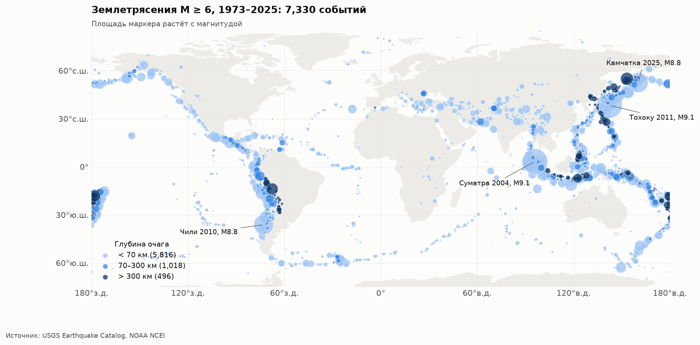
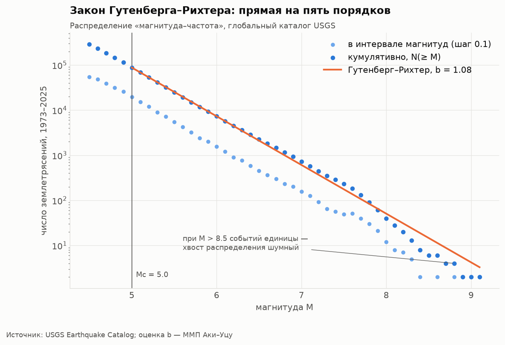
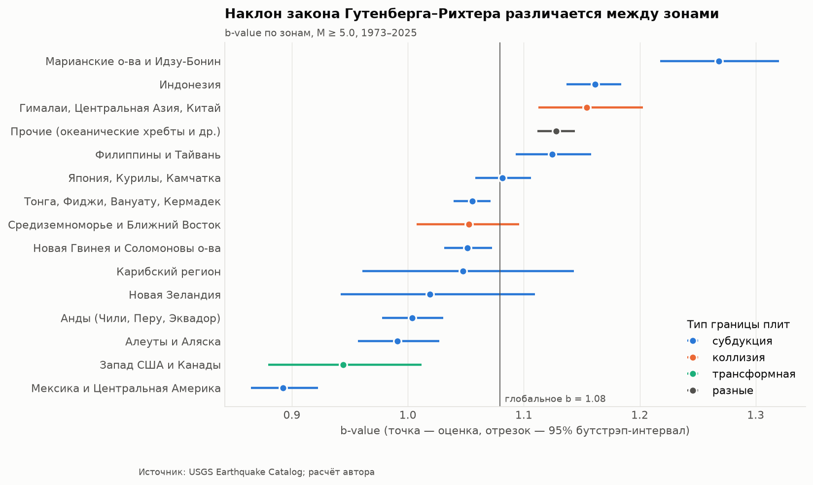
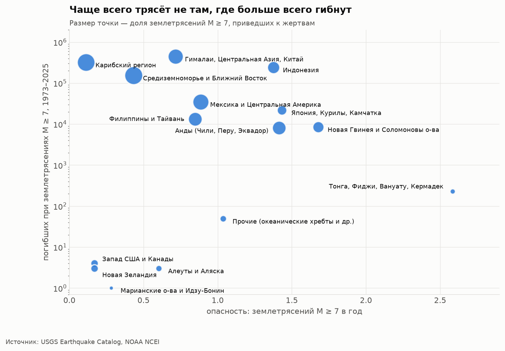
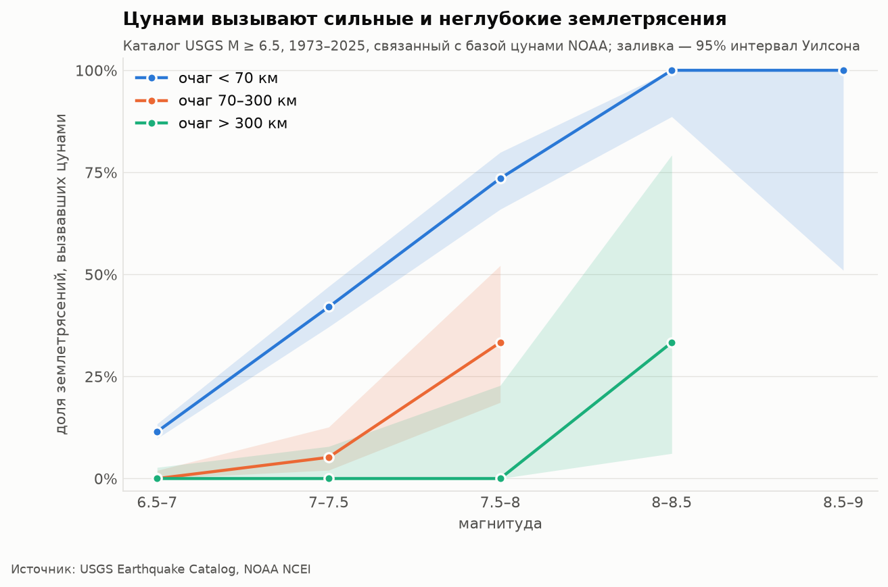
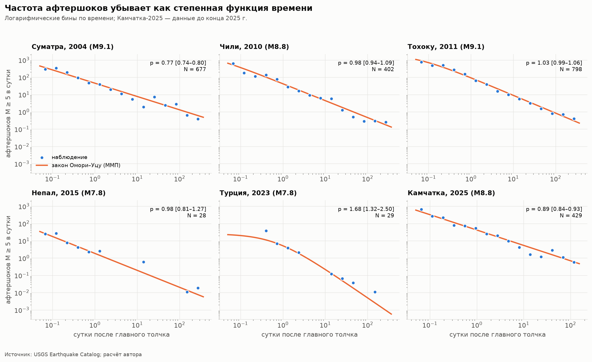

# Сейсмический риск: землетрясения и цунами в данных

Исследование мировой сейсмичности за 1973–2025 годы по открытым каталогам **USGS** и **NOAA**:
от загрузки сырых данных через API до проверки классических законов сейсмологии и оценки
последствий землетрясений для населения.

**Стек:** Python · pandas · NumPy · SQL (SQLite) · matplotlib · Jupyter · pytest



## Ключевые результаты

| # | Вопрос | Ответ |
|---|---|---|
| 1 | Выполняется ли закон Гутенберга–Рихтера? | Да: кумулятивное распределение — прямая на пять порядков, **b = 1.08** (95% ДИ 1.07–1.09) |
| 2 | Различается ли b-value между зонами? | Да, значимо: от **0.89** (Мексика и Центральная Америка) до **1.27** (Марианская дуга) |
| 3 | Можно ли по слабым событиям предсказать частоту сильных? | Для M ≥ 7 — да (корреляция прогноза и факта 0.96); для M ≥ 8 закон переоценивает частоту там, где размер разломов ограничивает Mmax |
| 4 | Независимы ли сильные землетрясения? | Почти: интервалы между M ≥ 7 близки к экспоненциальным (CV = 1.08), но очень коротких интервалов вдвое больше, чем при пуассоновском потоке |
| 5 | Совпадают ли зоны наибольшей опасности и наибольших потерь? | Нет. Самая активная зона (Тонга–Кермадек, 2.6 события M ≥ 7 в год) — одна из наименее смертоносных; Гималаи, Средиземноморье и Карибы — наоборот |
| 6 | Что определяет число жертв? | Магнитуда задаёт порядок (ρ = 0.36), но при равной магнитуде очаги до 20 км в медиане уносят почти в 10 раз больше жизней, чем очаги глубже 40 км |
| 7 | Когда возникает цунами? | Доля цунамигенных неглубоких землетрясений растёт с 12% при M6.5–7 до 100% при M ≥ 8; глубокие очаги цунами практически не вызывают |
| 8 | Как затухают афтершоки? | По закону Омори–Уцу с p ≈ 0.9–1.0 (Чили-2010, Тохоку-2011, Непал-2015, Камчатка-2025); отклонения объясняются «дуплетами» (Турция-2023) и вторичными крупными событиями (Суматра → Ниас) |

<table>
<tr>
<td></td>
<td></td>
</tr>
<tr>
<td></td>
<td></td>
</tr>
</table>



## Ноутбуки

| Ноутбук | Содержание | Инструменты |
|---|---|---|
| [01_data_pipeline](notebooks/01_data_pipeline.ipynb) | Загрузка, очистка, контроль качества, полнота каталога, карта, связывание USGS ↔ NOAA | pandas, regex, `merge_asof` |
| [02_sql_analytics](notebooks/02_sql_analytics.ipynb) | 10 аналитических запросов: CTE, оконные функции, условная агрегация, JOIN | SQL, pandas |
| [03_gutenberg_richter](notebooks/03_gutenberg_richter.ipynb) | b-value (ММП + бутстрэп), проверка прогноза, вероятности, пуассоновость | NumPy |
| [04_impact_and_tsunami](notebooks/04_impact_and_tsunami.ipynb) | Опасность против потерь, корреляции Спирмена, вероятность цунами с интервалами Уилсона | SQL, pandas, NumPy |
| [05_aftershocks_omori](notebooks/05_aftershocks_omori.ipynb) | Закон Омори–Уцу (ММП на сетке через broadcasting), закон Бота, прогноз афтершоков | NumPy |

Все графики сохраняются в [`figures/`](figures/).

## Данные

| Источник | Содержание | Объём |
|---|---|---|
| [USGS Earthquake Catalog](https://earthquake.usgs.gov/fdsnws/event/1/) | Все землетрясения мира M ≥ 4.5, 1973–2025 | 287 тыс. событий |
| [NOAA NCEI Significant Earthquake Database](https://www.ngdc.noaa.gov/hazel/view/hazards/earthquake/search) | Значимые землетрясения 1900–2025: жертвы, ущерб, разрушения | 4,1 тыс. |
| [NOAA NCEI Global Historical Tsunami Database](https://www.ngdc.noaa.gov/hazel/view/hazards/tsunami/event-search) | Цунами, вызванные землетрясениями | 1,1 тыс. |
| [Natural Earth](https://www.naturalearthdata.com/) | Контуры суши для карты (public domain) | — |

Сырые данные и база в репозиторий не входят, их воспроизводимо скачивает `python -m seismic.download`.

### Схема базы данных

```
zones ─┬─< events >── significant >── tsunamis
       │    (USGS)       (NOAA)          (NOAA)
```

- `events.zone_id → zones`: сейсмическая зона события;
- `significant.usgs_event_id → events`: связь NOAA и USGS, найденная сопоставлением по времени (±90 с), расстоянию (≤ 150 км) и магнитуде (Δ ≤ 0.8). Пару в USGS нашли 99% значимых событий после 1973 года;
- `tsunamis.noaa_eq_id → significant`: землетрясение, вызвавшее цунами.

DDL: [`sql/schema.sql`](sql/schema.sql), запросы: [`sql/queries/`](sql/queries/).

## Методы

| Задача | Метод | Реализация |
|---|---|---|
| Порог полноты каталога Mc | Максимальная кривизна (Wiemer & Wyss, 2000) | `stats.magnitude_of_completeness` |
| b-value | ММП Аки (1965) с поправкой Уцу; бутстрэп; ошибка Shi & Bolt (1982) | `stats.b_value_mle`, `stats.bootstrap` |
| Вероятность события | Пуассоновская модель, 1 − e^(−λT) | `stats.poisson_exceedance` |
| Отбор афтершоков | Окно Gardner & Knopoff (1974) и длина разрыва Wells & Coppersmith (1994) | `analysis.aftershock_sequence` |
| Закон Омори–Уцу | ММП для неоднородного пуассоновского процесса (Ogata, 1983), векторизованный перебор по сетке | `stats.fit_omori` |
| Доверительные интервалы долей | Интервал Уилсона | `stats.wilson_interval` |
| Расстояния | Формула гаверсинусов | `stats.haversine_km` |

Оценщики проверены на синтетических данных с известными параметрами ([`tests/test_stats.py`](tests/test_stats.py)).

## Структура проекта

```
seismic-risk-analytics/
├── data/
│   ├── geo/              # контуры суши (Natural Earth)
│   ├── raw/              # выгрузки API (в .gitignore)
│   └── processed/        # seismic.db (в .gitignore)
├── figures/              # графики, используемые в README и ноутбуках
├── notebooks/            # пять ноутбуков-глав исследования
├── sql/
│   ├── schema.sql
│   └── queries/          # 10 аналитических запросов
├── src/seismic/
│   ├── config.py         # пути и параметры
│   ├── download.py       # загрузка из API USGS и NOAA
│   ├── etl.py            # очистка (pandas) и загрузка в SQLite
│   ├── regions.py        # сейсмические зоны (векторно, NumPy)
│   ├── db.py             # выполнение именованных SQL-запросов
│   ├── stats.py          # статистическая сейсмология на NumPy
│   ├── analysis.py       # сценарии анализа: Г–Р по зонам, Омори
│   └── plots.py          # единый стиль matplotlib, карта
└── tests/
```

## Как запустить

```bash
git clone https://github.com/IrinaVasDM/seismic-risk-analytics.git && cd seismic-risk-analytics
python -m venv .venv && source .venv/bin/activate
make install   # зависимости + пакет seismic в режиме разработки
make data      # загрузка данных (несколько минут, ~10 МБ)
make db        # очистка и сборка SQLite
make notebooks # выполнить все ноутбуки и пересоздать графики
make test      # тесты
```

Без `make`: `pip install -r requirements.txt && pip install -e .`, затем
`python -m seismic.download`, `python -m seismic.etl`, `pytest`.

## Ограничения

- **Неоднородность магнитуд.** Слабые события в каталоге измерены в основном по mb, сильные — по Mw. Это сдвигает абсолютные значения b-value; сравнение зон между собой надёжнее.
- **Районирование упрощено.** Зоны заданы прямоугольниками широты и долготы, а не стандартным районированием Флинна–Энгдаля.
- **Потери в NOAA** собраны из исторических источников, их полнота растёт со временем; для ранних событий указаны оценки.
- **Не прогноз.** Вероятности в ноутбуке 3 — учебная пуассоновская оценка, а не официальная оценка сейсмической опасности.
